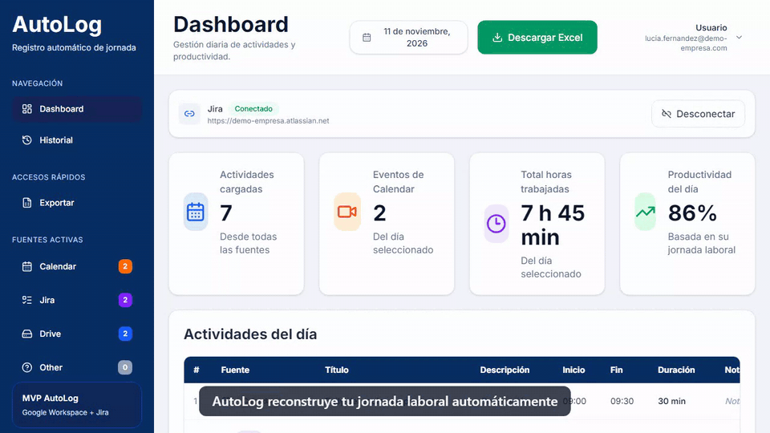
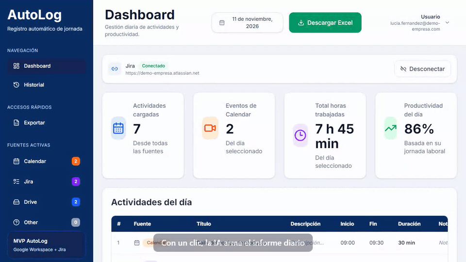
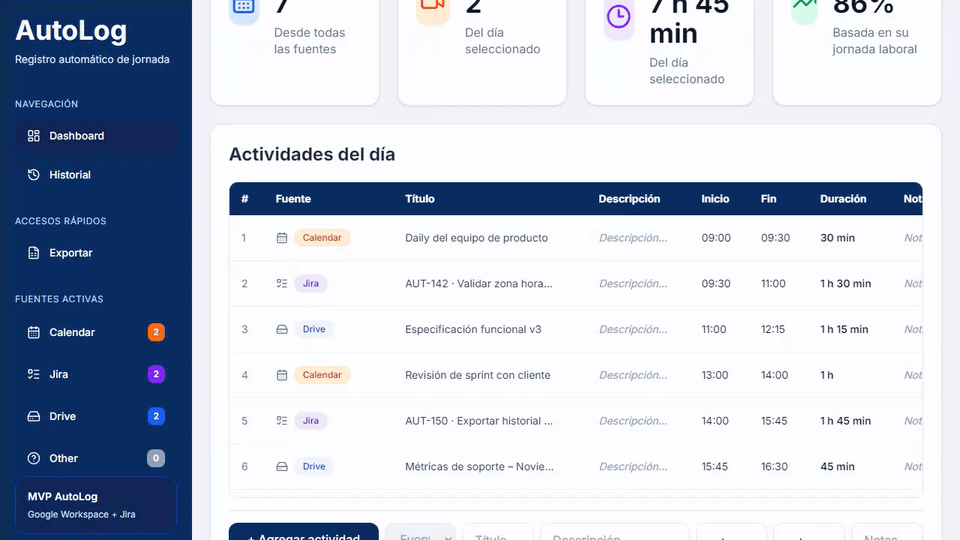
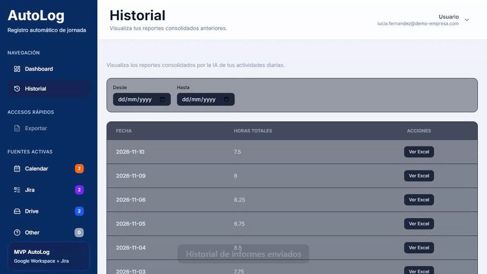
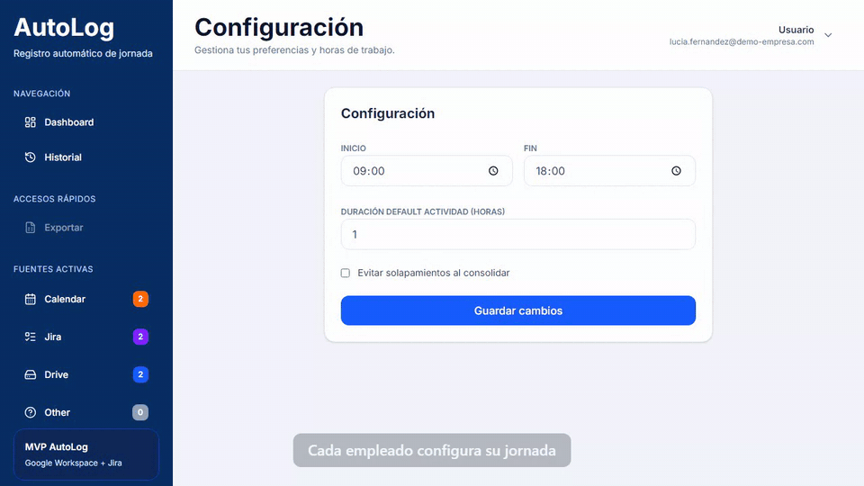
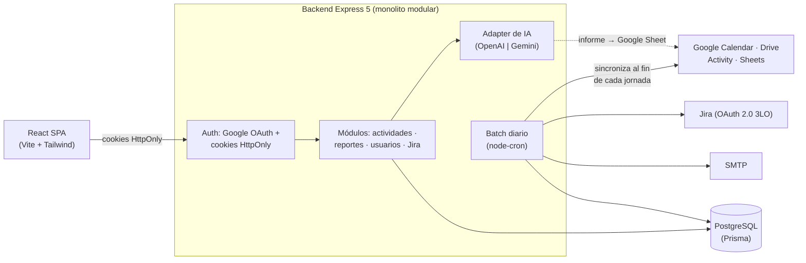

# AutoLog

> Registro automático de la jornada laboral: AutoLog reconstruye lo que hizo cada empleado en el día a partir de
> **Google Calendar**, **Google Drive** y **Jira**, y genera un **informe diario con IA** que se guarda como Google
> Sheet en su Drive.

Proyecto final de la carrera **Analista en Sistemas** (ORT Belgrano), desarrollado en equipo. Este repositorio es una
**vitrina**: resume el producto, la arquitectura y mi aporte. El código está en
[proyecto-final-back](https://github.com/LicFuraca/proyecto-final-back) y
[proyecto-final-front](https://github.com/Equipo-4-ORT/proyecto-final-front).

[Demo](#demo)  ·  [Arquitectura](#arquitectura)  ·  [Stack](#stack)  ·  [Mi rol](#mi-rol)

---

## El problema

Cargar horas a mano es tedioso y poco confiable: al final del día cuesta recordar en qué se fue el tiempo, y la
información ya existe repartida en el calendario, en los documentos que se editaron y en los tickets que se movieron.

## La solución

- **Ingesta automática** de la actividad del día desde tres fuentes, unificada en una sola línea de tiempo:
  reuniones de Calendar, archivos creados o editados en Drive y worklogs, comentarios y transiciones de Jira.
- **Batch diario**: al terminar la jornada de cada empleado (según su horario y zona horaria) sincroniza su actividad
  y le avisa por email.
- **Informe con IA** generado a demanda (OpenAI o Gemini, intercambiables) y guardado como Google Sheet en el Drive
  del empleado.
- **Carga manual** para lo que no deja rastro digital, con métricas del día recalculadas al instante.
- **Panel de administración** para gestionar empleados y roles.

## Demo

> Grabado con una empleada ficticia y datos de ejemplo: no hay datos reales de personas ni empresas.

El GIF de arriba muestra el dashboard: reuniones, archivos y tickets del día en una sola tabla, con horas trabajadas,
productividad y distribución por fuente.

### Informe diario con IA

Un clic genera el informe del día y lo guarda como Google Sheet.

### Carga manual

<b>Más: historial de informes y configuración de la jornada</b>

### Historial

### Configuración de la jornada

El horario de cada empleado define cuándo corre su sincronización diaria.

---

## Arquitectura

Puntos destacados:

- **Sesiones seguras**: access token JWT de vida corta en cookie `HttpOnly` + refresh token rotativo con detección de
  reuso (si se reutiliza uno viejo, se revocan todas las sesiones).
- **Tokens de terceros cifrados** (AES-256-GCM) para que el batch pueda sincronizar en segundo plano.
- **Idempotencia**: re-sincronizar el mismo día no duplica actividades (clave única por usuario, fuente e id externo).
- **IA intercambiable** con patrón Adapter: entrada sanitizada contra prompt injection, salida validada con Zod y
  escape de fórmulas antes de escribir la planilla.
- **Zonas horarias**: todo se guarda en UTC y el "día" de cada informe se interpreta en la zona configurada.

## Stack

| Capa | Tecnologías |
|---|---|
| **Backend** | Node.js 20+, Express 5, Prisma 6, PostgreSQL 15, Zod, Luxon, node-cron, Nodemailer |
| **Frontend** | React 19, Vite, Tailwind CSS 4, React Router 7, Axios, Recharts |
| **Integraciones** | Google OAuth 2.0, Calendar, Drive Activity y Sheets (googleapis), Jira OAuth 2.0 (3LO) |
| **IA** | OpenAI y Google Gemini detrás de un adapter común |
| **Testing** | Jest + Supertest (backend), Vitest + Testing Library (frontend), cobertura mínima del 80 % |
| **DevOps** | Docker / Docker Compose, GitHub Actions (CI, CodeQL, escaneo de seguridad, guarda de PRs) |

## Mi rol

Proyecto en equipo. Mis principales aportes, sobre todo en el backend:

- **Base del backend**: estructura de la API (Express), dockerización, esquema de Prisma, migraciones y seed inicial.
- **Autenticación y seguridad**: login con Google, middleware de autenticación y manejo de errores, cifrado de
  tokens, rate limiting de la API y validación de links maliciosos, con sus tests.
- **Usuarios y configuración**: CRUD de usuarios, configuración de la jornada y reportes por usuario.
- **Integraciones**: sincronización de Google Calendar y unificación de la línea de tiempo de actividades.
- **Informe diario con IA**: generación de los informes con Gemini 2.5 y su historial.
- **Frontend**: correcciones en el dashboard, el historial y la página de administración.

## Contacto

> Datos de contacto: próximamente.
